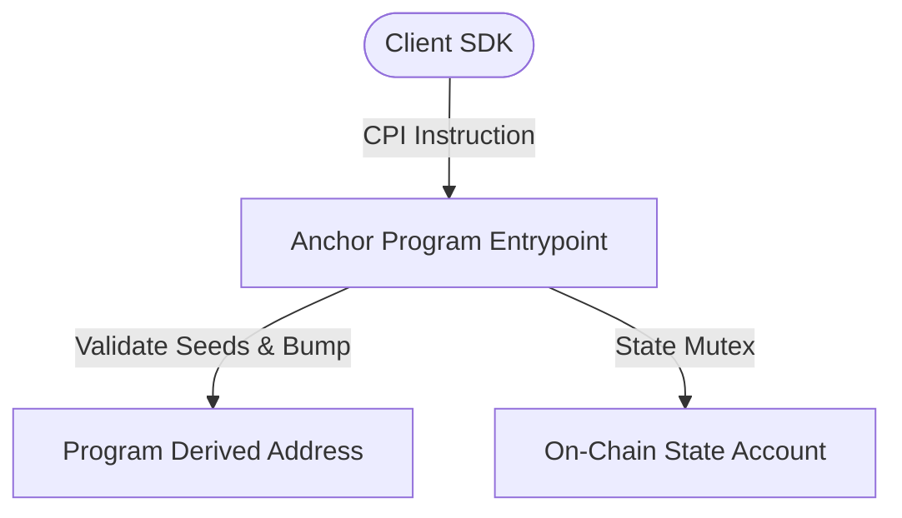

# solana-orca-whirlpool-rebalancer

[](https://solana.com)
[](https://www.rust-lang.org)
[](https://opensource.org/licenses/MIT)

Concentrated liquidity Whirlpool range adjuster and tick spacing liquidity manager on Solana.

## Architecture



## Highlights
- **Anchor 0.30 Framework**: Clean type-safe account validation macros.
- **Zero-Copy Deserialization**: High throughput processing under extreme network load.
- **SPL Token Compatibility**: Native support for standard SPL Token and Token-2022 extensions.

## Build & Test
```bash
anchor build
anchor test
```

## License
MIT
